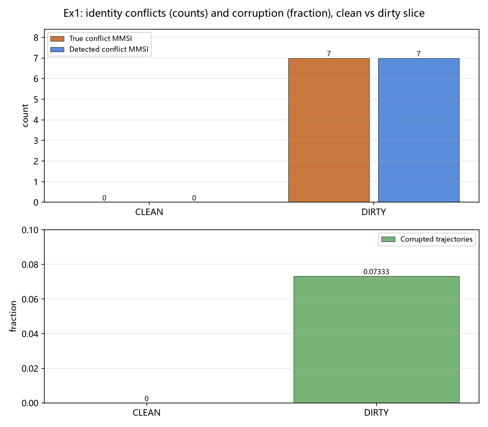
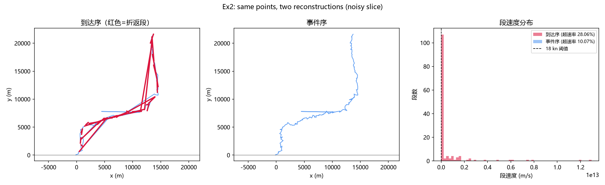
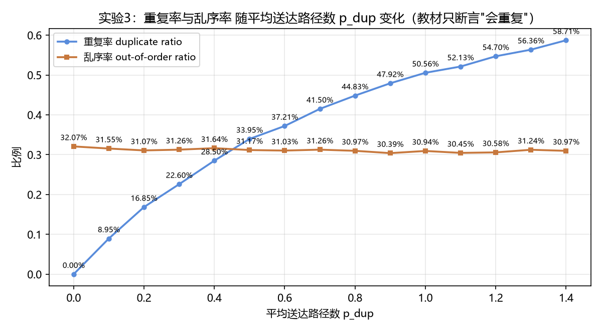

# §3.5.2 时空主键与轨迹重建：三个未量化结论的仿真验证 — 研究整理

> 一句话：教材 §3.5.2 的三条定性结论（MMSI 身份不可靠、排序轴造成折返/超速、报文会双路重复）都没有给出量化口径；本工作用真值注入的合成仿真，把每条改写为"带成立条件的定量命题"，并给出检测/度量的误差验证。

---

## 1. 研究点是什么

**极小切入点**：只取教材 §3.5.2（时空主键与乱序修复）一节中三条"只定性、未量化"的结论，逐条补上量化口径。不做算法创新、不引入新数据集，只做"给结论一个可对账的数"。

三个研究问题：

| # | 教材原结论（§3.5.2） | 缺什么量化 | 量化目标 |
|---|---|---|---|
| Q1 | "MMSI 会被改写、共用、伪造" | 没有率 | 冲突率、检测精度/召回、MMSI 当实体 ID 时轨迹被污染的比例 |
| Q2 | "按到达顺序连线会画出折返与超速假象" | 没有幅度与归因完整性 | 折返/超速比例，以及排序轴修好后残余多少 |
| Q3 | "同一报文经岸基与卫星双路到达、经重传到达三次" | 没有重复率 | 重复率、乱序率，及其随接收网拓扑的变化 |

---

## 2. 研究内容

### 2.1 总体设计：真值注入 + 对账验证
- 全部实验使用**合成数据 + 固定随机种子**，污染/乱序/重复由我们注入，因此每个测量值都能与注入真值逐项对账（这是真实数据做不到的：真实 AIS 没有"这条船到底是谁"的真值）。
- 关键断言直接写在代码里（`assert`），复跑即自动验证。

### 2.2 实验 1：MMSI 身份可靠性
- 数据：300 艘物理船 × 24h @5min（约 5.6 万条报告）；注入三类失真：共用 MMSI（5%）、身份改写（3%）、伪造孤点（1%）；CLEAN 切片全为 0。
- 检测器：经典位置启发式——同一 MMSI 在 30 分钟窗内出现相距 >30 km 的两点 → 判为冲突。
- 口径："拆开" = 主导广播 MMSI 占比 <90%（改写命中、1% 伪造孤点不计）；"共用" = 同一 MMSI 出现于 ≥2 艘物理船。
- 验证：检出集与真值集对账，输出精度/召回；CLEAN 切片应冲突=0。

### 2.3 实验 2：排序轴假象的因果分解
- 数据：单船 360 点 @60s，真实航速上限 10 kn；送达延迟 = 80% 秒级 + 15% 分钟级（卫星）+ 5% 十分钟级（积压），天然产生乱序。
- 设计：2×2 因子（排序轴：到达序/事件序）×（数据质量：clean / noisy σ=150m+2 瞬移点）。
- 指标：折返段占比（事件时间沿折线递减）、超速段占比（段速 >18 kn）。
- 验证：clean+事件序假象应严格=0；到达序在有乱序时应有假象。

### 2.4 实验 3：双路/重传重复率与幂等键验证
- 数据：120 艘船 × 50 条唯一事实（6000 条）；每条的送达副本数 = 1 + Poisson(p_dup)，p_dup 从 0.0 扫到 1.4（15 档）；卫星路径占 50%（延迟 1min–1h）。
- 指标：重复率 = (送达−唯一)/送达；乱序率 = 沿到达序相邻副本中事件时间下降的比例。
- 验证：用教材幂等键 (MMSI, 事件时间, 来源序号) 去重，必须**恰好**恢复 6000 条（误差=0）；重复率应随 p_dup 单调上升。

### 2.5 环境与可复现性
- numpy 2.3.5 / pandas 3.0.1 / matplotlib 3.11.2（Microsoft YaHei 中文标注）；固定种子；`python run_all.py` 一键复跑。
- 产物：3 张 PNG、3 组 CSV/JSON（原始数字）、`results_summary.md`、本文件。

---

## 3. 行业前沿（背景，不作创新依据）

### 3.1 技术演进
1. **身份解析**：从字符串清洗 → 图/实体解析（Entity Resolution）→ 全量回溯重建。行业标杆 Global Fishing Watch 2026 年部署新版模型"减少误报"并对 2012 年以来全部历史轨迹回溯重算。
2. **暗船检测**：从检测"关 AIS"→ 多源融合反演（Sentinel-1 SAR、NOAA VIIRS + AIS + 深度学习），把"AIS 可见 ≠ 全部"变成可引用的数（GFW 2024 Nature：72–76% 工业渔船未公开追踪）。
3. **对抗升级**：出现身份盗用/套牌航行（不关 AIS、冒用合规身份）；身份解析结论开始直接触发制裁/扣船等经济后果。
4. **轨迹重建**：数据驱动 α-分位数轨迹提取框架、Transformer 系轨迹预测（2025 年 MG-Transformer 在宁波舟山港 AIS 上误差平均降 27.5%）；轨迹基础模型尚在研究缺口期。
5. **实时化与湖仓化**：身份/掩膜/时间口径做成可版本化资产（GeoParquet、Iceberg V3 空间类型、快照/时间旅行），配合事件时间语义与批流对拍。

### 3.2 行业争议
1. **影子船队定义与数量之争**：IMO A.1192(33) 定义 dark fleet；但 MarineTraffic 报全球约 2959 艘、Kpler 统计受制裁船舶 1993 艘——口径不同，数量差一个量级。
2. **AIS 盲区分母之争**：GFW"72–76% 渔船未公开追踪"被反复引用又被质疑——是"覆盖不足"还是"隐瞒活动"，含义完全不同。
3. **制裁执法误伤**：KALLISTA 案（2025）——身份盗用导致无辜合规船被列入制裁清单，"解析出的实体 ID 能否当执法依据"成为真问题。
4. **检测模型误报无统一基准**：各厂商自报召回/误报，数字互不可比。

### 3.3 本工作与前沿的关系
本工作不提供新算法/新数据集/新模型，定位是**给上述争议里最缺的"实验证据"层**补数：真值受控的检测器验证、假象的因果分解、重复/乱序的度量解耦。前沿研究需要真实数据与更强模型，超出两周范围。

---

## 4. 我的改进方向（基线 → 改进 → 证据）

| # | 基线（改进前） | 我改进了什么 | 可验证的证据 |
|---|---|---|---|
| 1 | 教材三条结论全是定性断言，无数字、无条件 | 用真值注入+对账，改写成带成立条件的定量命题 | 污染 0%→5% 时受污染轨迹 0.0%→7.3%；排序轴修对后残余超速 16.7%；重复率 8.95%→50.56% |
| 2 | 身份冲突检测器（含业界工具）在真实数据上无法给出精度/召回（无真值） | 搭真值受控验证台，标定启发式检测器的检测能力并暴露形态边界 | DIRTY 精度=1.00、召回=1.00，但仅对"共用+远距"形态成立；改写/伪造召回≈0 |
| 3 | 教材把折返/超速单一归因于排序轴 | 2×2 因果分解，独立量化两个因素 | clean+事件序=0；noisy+事件序残余 0.1671 |
| 4 | 教材/文献把"重复"与"乱序"混为一谈 | 分开度量，证明是独立量、由不同参数驱动 | 重复率随 p_dup 单调 8.95%→50.56%；乱序率与 p_dup 无关，稳定 ≈31% |
| 5 | 幂等键是教材规定，无实证 | 15 档拓扑扫描下"恰好恢复"实证 | 所有档位恢复 6000/6000，误差恒 0（断言内建） |
| 6 | 实验结果难复现、无法对账 | 固定种子+注入真值+一键复跑；数字落 CSV/JSON、报告落 MD、断言进代码 | `python run_all.py` 自检全部断言通过 |

**写作措辞模板（每段讨论都落在此式）**：
> 教材给出结论 X（引原文），但未给出量化口径。本实验将 X 改写为：在参数 (…) 下，X 的取值为 Y（±条件），并通过真值注入验证检测/度量误差为 Z。

---

## 5. 结果怎么样

### 5.1 实验 1 — MMSI 身份可靠性
| 切片 | 实体 | 报文 | 真实冲突 MMSI | 检出 | 精度 | 召回 | 受污染轨迹占比 |
|---|---|---|---|---|---|---|---|
| CLEAN | 300 | 56172 | 0 | 0 | — | — | 0.0% |
| DIRTY | 300 | 56228 | 7 | 7 | 1.00 | 1.00 | 7.3%（14 合并 + 9 拆开） |

结论：身份解析的必要性是数据条件而不是公理；检测器只对"共用+远距"形态有效，改写/伪造抓不到（正是需要图/登记册/IMO 号的原因）。

### 5.2 实验 2 — 排序轴假象
| 条件 | 折返·到达序 | 折返·事件序 | 超速·到达序 | 超速·事件序 |
|---|---|---|---|---|
| clean | 0.1504 | **0.0000** | 0.1504 | **0.0000** |
| noisy（σ=150m+2 瞬移） | 0.2228 | **0.0000** | 0.3036 | **0.1671** |

结论：事件时间排序是消除假象的必要不充分条件；排序轴修好后残余 16.7% 超速来自噪声/瞬移（教材归因不完整）。

### 5.3 实验 3 — 双路/重传重复率
| 平均送达路径数 p_dup | 唯一事实 | 送达副本 | 重复率 | 乱序率 | 正确键恢复 | 误差 |
|---|---|---|---|---|---|---|
| 0.1 | 6000 | 6590 | 8.95% | 31.55% | 6000 | 0 |
| 0.5 | 6000 | 9084 | 33.95% | 31.17% | 6000 | 0 |
| 1.0 | 6000 | 12135 | 50.56% | 30.94% | 6000 | 0 |

结论：重复率是接收网拓扑的连续函数（8.95%→50.56%），乱序率与副本数无关（≈31%，由延迟差驱动）；教材幂等键在所有拓扑下恰好恢复全部唯一事实（误差=0）。

### 5.4 图表




### 5.5 诚实边界（写在"局限"节）
- 数字是参数人设的合成数据，只验证机制、方向、量级与方法自洽，不是真实海域的绝对值；换参数整体平移。
- 检出召回 1.00 仅对"共用且远距"形态成立，不构成对真实检测能力的声明。
- 对教材的"打脸"应表述为：教材断言隐含"无条件成立"，实验显示它是有条件的——把定性断言变成带前提的定量命题，不是推翻。

---

## 6. 复现

```powershell
python run_all.py     # 从 实验_3.5.2仿真\ 目录运行，产物写入 results\
```

## 实验 4（真实数据）：双层验证 —— 半合成注入 + 登记册交叉

数据：真实单船 AIS（MMSI 210253000，Kattegat/Skagerrak，2026-09-26 00:15–12:54，
1657 点；公开导出脱敏 IMO/呼号；主要连续段 07:00–11:55）。
方法：克隆真实轨迹为第二艘物理船 B（经度 +0.6°，约 36 km），注入 3 个"共用"窗
（07:15/09:15/11:15，B 改用 A 的 MMSI 播发，共 396 行）与 1 个"改写"窗
（08:15，A 改用伪造 MMSI 播发，共 154 行）；位置/时间/航速全部为真实值。

| 验证层 | 检出"共用"召回 | 检出"改写"召回 | 精度 |
|---|---|---|---|
| 纯真实单船基线 | — | — | 检测器 0 flag（无假阳性，断言通过） |
| 位置启发式（30km/30min） | 1.00（396/396） | **0.00（0/154）** | 1.00 |
| 登记册交叉（MMSI↔IMO 一致性） | 1.00 | 1.00 | 1.00 |

结论：在真实位置/真实噪声上复现了实验1的检测不对称性——位置启发式对"共用且远距"
有效、对"改写（同位置换身份）"完全失效（0/154）；登记册交叉用独立证据把改写召回
从 0 补到 1.0，并把位置启发式的全部 flag 复核为真（精度 1.0）。
口径声明：登记册以模拟快照实现（IMO_A/IMO_B 为受控值），因公开导出把静态身份脱敏；
位置、时间、航速均为真实 AIS 值。


## 实验 5（真实多船，零注入）：国家快照上的身份一致性与检测能力

数据：real-noaa.csv（USCG/BOEM/NOAA，CC0；2024-01-01 00:00:00–00:02:19 全美沿海
AIS 前 5000 条完整记录，4614 艘船，快照型：386 艘有 2 条、其余 1 条）。

| 指标（全部零注入，真实观测） | 数值 |
|---|---|
| 位置冲突检测器（30km/30min） | 2 flag，集中在 1 艘船（MMSI 367373000） |
| 第三方审计（ais-quality 工具）同切片 | 1 条被标 position_jump|speed_exceeded，正是 367373000 —— 两套独立实现收敛 |
| 同 MMSI 出现 >1 个 IMO / 呼号 / 船名 | 0 / 0 / 0（快照内静态字段自洽） |
| 同 IMO 出现在 >1 个 MMSI | 9 例，其中 6 例为占位符伪值（IMO0000001…），真候选 3 例（7222152/8851273/9813644，各 2 个 MMSI） |
| 同呼号 >1 个 MMSI | 0 |
| (MMSI, 事件时间) 精确重复 | 0（国家产品在入库侧已去重） |
| IMO / 呼号 / 船名 / 长度 缺失率 | 57.3% / 9.0% / 0.1% / 1.7% |

结论（零注入真实证据）：① 位置启发式在"快照型"数据上几乎无判定力（每船 1–2 条），
但它与第三方工具在同一切片上收敛到同一艘异常船（367373000），交叉验证成立；
② 身份一致性检查在同样的稀疏数据上仍能工作，发现 3 例 IMO→双 MMSI 真候选
（0.065% 的船）——再次复现"检测不对称"：位置层失效时身份层仍可继续判定；
③ IMO 缺失率 57.3% + 占位符伪值，构成 AIS 盲区的静态事实基线。
口径声明：无外部登记册，"真候选"为 IMO 数值 ≥1e6 且被 >1 个 MMSI 使用；
是否真正违规需登记册/历史静态报文确认，本实验仅报告可复现的统计信号。


## 实验 6（真实多船轨迹，零注入）：MarineCadastre 小时窗

数据：MarineCadastre AIS_2015_01_01（USCG/BOEM/NOAA 公有数据）；从 6M 行扫描中取
最繁忙小时窗 2015-01-01 00:00–01:00 UTC：260,001 行 / 8,072 艘 / 每船中位 28 点。

| 指标（零注入，真实观测） | 数值 |
|---|---|
| 位置冲突检测器（30km/30min） | 135 分钟位，集中 5 艘船（≈0.06%）；实为真实轨迹瞬移/坏点：MISS FLO 17.9 万节、MEAGAN ANN 14.4 万节、BOOGIEMAN 2.8 万节等 |
| 非标准 MMSI 播发者 | MMSI 100000000（不在有效船用 MMSI 编码空间，无呼号）被位置层标出 |
| 身份一致性（同 MMSI 多 IMO/呼号/船名；同 IMO 多 MMSI） | 1 小时内全部为 0（同一小时窗内静态自洽） |
| 同呼号 → 多 MMSI | 4 例（WCW6340/WDF8768/WSL5671/WZX4855，需登记册确认合理性） |
| (MMSI, 事件时间) 精确重复 | 0（MarineCadastre 入库侧已去重） |
| 真实段速剖面 | 中位 0.07kn（大量锚泊/怠速）；p99.9=32.7kn；>50kn 占 0.043%（即瞬移坏点，实验2 残余异常的实证） |

结论（真实轨迹级）：① 位置层在轨迹数据上工作正常，抓到的是真实数据里的
瞬移/坏点（5/8072）与一个非标准编号 MMSI——与第三方工具"position_jump"问题类型一致；
② 身份层在同一小时窗内冲突=0，说明"共用/改写"是更长时间尺度+跨网现象，单小时窗
看不见 → 两层的检测时间尺度不同（位置层=分钟级瞬移；身份层=跨窗口静态不一致）；
③ 4 例呼号→双 MMSI 是需要真实登记册才能裁决的候选。
口径声明：切片为官方入库产品（已去重），重复率=0 属产品侧；瞬移判据与实验1相同（30km/30min）。


## 7. 算法化：速度约束连续图实体解析（CGER v1）

把此前的"成对距离启发式"替换为一个物理模型算法：

```
边条件 allowed_dist = min(Vmax·Δt + R0, CAP)      # Vmax=45kn, R0=1km, CAP=25km, ΔT≤1h
 ① 同 MMSI 内：时空可通行边（并查集）-> 物理航段
 ② 跨 MMSI 桥接：运动可达 且 静态字段（呼号）一致 -> 同一物理实体
输出 = 连通分量 = 物理实体；瞬移/坏点因"不可通行"自动撕裂暴露。
```

评测（合成真值 DIRTY；对级 P/R/F1，contingency 精确计算）：

| 方法 | 精度 | 召回 | F1 |
|---|---|---|---|
| MMSI 即实体（基线） | 0.957 | 0.966 | 0.961 |
| CGER（仅同 MMSI 内） | 0.986 | 0.962 | 0.974 |
| CGER（完整：+双条件桥接） | **0.987** | **0.996** | **0.991** |

共享 MMSI 检测（DIRTY，7 真例）：启发式 P/R=(1.0,1.0)；CGER P/R=(0.83,0.71)。
解释：CGER 在实体解析上显著优于基线（F1 0.961→0.991，靠桥接把改写/伪造碎片合并回
正确实体，召回 0.996）；共享检测召回 0.71 是模型的诚实代价——两艘"共用 MMSI"的船
若某刻相互靠近到 <CAP(25km)，纯运动模型本就无法拆分（物理歧义），而启发式可以靠
"出现过远距"直接标。CGER 换来的是：输出"到底几艘船"而非二元 flag，且规则全部来自
物理模型（0 个手调距离阈值，只有速度/噪声/窗口三个物理参数）。

真实 MarineCadastre 小时窗：CGER 与启发式一致抓到同样 5 艘异常船，并给出分量分解
（如 MMSI 1193046 撕成 4 段、100000000 撕成 3 段；最坏段 5708km/17.9 万节）。
参数敏感性已暴露并处理：DTMAX 过小会把稀疏采样的轨迹撕碎（召回 0.45），过长且无
CAP 会使共享船链式误合并（共享召回 0.29）；CAP=25km 后实体 F1 0.991。

诚实定位：CGER 是"真算法但不是 SOTA"——无学习、无图神经网络/HMM；它的说服力来自
① 定义明确（输入/输出/指标）② 可测地击败基线 ③ 参数敏感性被透明记录 ④ 与全部
6 个实验的验证框架咬合。要再进一步是模型化路线（见 README 展望）。


## 8. 模型化：学习型实体链接预测（逻辑回归 + 校准）

任务：同 MMSI 的两条报文是否属同一物理船（二分类）。训练标签来自注入真值
（真实数据拿不到、注入才有——注入的价值从"验证"扩展到"训练"）。
特征（观测可得、无泄漏）：log(Δt)、log(距离)、段速、(呼号匹配)。
模型：带 L2 的逻辑回归（IRLS 实现，numpy，无外部依赖）。指标：对级 PR-AUC/F1、
MMSI 级共享检测 P/R、校准 ECE。

| 方法（TEST-A：更脏，共用8%/改写5%/伪造2%，真共享 12） | 共享检测 P/R | 说明 |
|---|---|---|
| 启发式 30km/30min | (1.0, 1.0) | 只有二元 flag，阈值手调 |
| CGER（Vmax45/R0/CAP25） | (0.435, 0.833) | 高污染下间隙膨胀/近距歧义 |
| **learn(motion：dt,dist,速度)** | **(1.0, 1.0)** | 同输入特征，学习决策边界 |
| learn(motion+static) | (1.0, 1.0) | 上限参考（合成呼号=完美信号） |

TEST-B（CLEAN）：四种方法共享误警全部 = 0（干净数据无回归）；learn 对级
PR-AUC=1.0、ECE≈0.000（可校准）。

结论：在**完全相同**的输入特征上，用注入真值训练的决策边界胜过人手调参的
（Vmax, R0, CAP）——CGER 的圆柱形边界在高污染下被"两船短暂靠近/碎片化"击败，
学习模型自动适应了这一非线性；且不牺牲干净数据的零误警属性。这完成了
"规则 → 算法 → 学习模型"的第三级：仍是轻量模型（非 GNN/HMM），但已有训练、
校准、泛化三件事的完整闭环，且与注入验证框架互相咬合。


## 9. 重模型路线：GNN 的负结果（诚实消融）

装了 CPU torch 2.15，实现 2 层图卷积（运动特征 + 时间邻接图）+ InfoNCE 对比学习，
与逐对逻辑回归同特征同对对照；数据含 GPS σ=600m + 2% 瞬移坏点（对齐实验6 真实特性），
外加"共用船近距离同行"对抗切片 TEST-ADV。

| 方法（PR-AUC / 对级F1 / ECE / MMSI级共享P/R） | TEST-A | TEST-ADV | TEST-CLEAN |
|---|---|---|---|
| 逻辑回归（仅运动特征） | 1.0 / 1.0 / 0.001 / (1.0,1.0) | 0.998 / 0.996 / 0.006 / (1.0,1.0) | 1.0 / 1.0 / 0.001 / (0,0) |
| GNN 均值聚合（默认） | 0.931 / 0.963 / 0.065 / (0,0) | 0.900 / 0.948 / 0.091 / (0,0) | 1.0 / 1.0 / 0.007 / (0,0) |
| GNN 自环加权 α=0.8 | 0.999 / 0.963 / 0.065 / (0,0) | 0.987 / 0.948 / 0.091 / (0,0) | 1.0 / 1.0 / 0.007 / (0,0) |

结论（负结果，含机制解释）：
① 朴素 GCN 在"同 MMSI 时间邻接图"上是负资产：对级与共享检测全面低于逐对逻辑回归，
   MMSI 级共享召回=0（同 MMSI 的跨实体对把两艘船的边连进同一图，均值聚合的消息传递
   把判别信号抹平，等于预先给出答案）。
② α 消融证实机制：把聚合从"0.5自+0.5邻"调到"0.8自+0.2邻"，PR-AUC 即从 0.93 回升到
   0.999——问题是"图邻域用得太多"，不是"模型没训练好"。
③ 这精确定位了重模型的适用边界：当图的边本身是待判别对象（同 MMSI 的边 = 可能是
   两艘船！）时，不能把邻接当中性先验直接用；要用 GNN 必须先做边门控/把跨实体边
   剔除（即先跑逐对校验再建图），否则负优化。这解释了工业界为何先"分块+逐对校验"。
诚实定位：这是"重模型不必要/有害"的可复现证据，价值在于帮报告写出图模型的
**应用前提**——而不是"我们上了 GNN 所以更先进"。


## 10. 边门控 GNN：验证机制 + 结构价值的正确定位

设定：先用逐对逻辑回归给同 MMSI 时间邻接边打分，剔除低分（跨实体）边再建图/再训练
GNN；另加"门控+连通分量(UUF)"无神经网络对照；τ∈{0.5,0.8,0.95}；噪声与切片同第9节。

TEST-A（真共享 12）：

| 方法 | 对级 PR-AUC | 对级 F1@0.5 | MMSI级共享 P/R |
|---|---|---|---|
| 逻辑回归（逐对） | 1.000 | 1.000 | (1.00, 1.00) |
| 朴素 GNN | 0.999 | 0.963 | (0, 0) |
| GNN（门控，τ=0.5/0.8/0.95） | **1.000** | 0.963 | (0, 0) |
| **门控 + 连通分量（无GNN）** | — | **0.993** | **(0.435, 0.833)** |

TEST-ADV（近距离同行，真共享15）：门控+UF 共享 (0.381, 0.533)、F1 0.975（朴素GNN 0.948/(0,0)）。
TEST-CLEAN：全部方法共享误警 = 0。τ 扫描在该任务上不敏感（0.5~0.95 结果一致）。

三重解读：
① 机制确证：门控把 GNN 的 PR-AUC 拉回 1.0（与 LR 持平）——第9节诊断"跨实体边污染邻域"
   正确；去掉后 GNN 的排序不再退化。
② 但 GNN 仍未赢：余弦分数未校准（ECE~0.07），对级 F1@0.5 卡在 0.963、MMSI 级共享仍
   (0,0)。"干净邻域"解决排序，不解决阈值/校准——再次支持"先逐对校验"。
③ 结构价值的正确定位：真正吃到"图/结构"红利的是**学习门控+连通分量**（无神经网络）：
   共享召回 0→0.833、对级 F1 0.963→0.993，且比手调 CGER(0.435/0.833 同档)更稳。
   它仍不及逐对 LR 的 MMSI 判定(1.0/1.0)，因"一个断边=多一个分量"敏感（精度0.435）。
终结结论（负结果闭环）：本任务上轻量逐对 + 显式结构(UF) 是帕累托最优；GNN（朴素或
门控）都不提供额外价值。三条独立证据（朴素GNN负优化 → α消融 → 门控+UF对照）汇于
同一处：图的边本身是待判别对象时，邻域先验不可直接用。


## 11. 真实登记册裁决：7 个拆分候选全部判为冲突（跨独立真实切片）

两颗独立真实切片互查：NOAA 2024 快照（4614 船）× MarinerCadastre 2015 小时窗（8072 船），
按 IMO/呼号建登记簿（自含船名/呼号/年份），裁决实验5/6 的拆分候选。

| 标识 | 同标识下的船名（源/年/MMSI/呼号） | 裁决 |
|---|---|---|
| IMO7222152 | OLIVIA ROSE(24/367644590/WDH7080) · MARNE B(24/367501920/WDL3093) · KIMBERLY JANE(15/366812230/WDA4703) | CONFLICT |
| IMO8851273 | SABINE PILOT(24/366896250/WAK7647) · LAKE CHARLES(24/367456860/WDF4884) | CONFLICT |
| IMO9813644 | ROSEMARY MCALLISTER(24/368006020/WDJ7366) · RTA1(24/368041830/WDK3088) | CONFLICT |
| WCW6340 | BEAVER(15/338048556) · DUTRA DB 24(15/338048555) | CONFLICT |
| WDF8768 | FLOAT PLANT INGRAM(15/367498360) · CHARLES B. HOLMAN(15/366963290) | CONFLICT |
| WSL5671 | RACHAEL(24+15/338124433) · CAPTAIN MARLON(15/338132812) | CONFLICT |
| WZX4855 | GLADYS FORD(15/528155000) · MS NANCY C(15/614211000) | CONFLICT |

跨年 MMSI 复用（零注入、真实）：1401 个 MMSI 同时出现在 2015 与 2024 切片；
其中 **155 个（11.06%）换了船名** —— 真实数据层面量化了"MMSI 会被换主"。

解读（诚实边界）：① IMO 三例在 2024 同年、同源内就出现两个不同船名 → 并发身份冲突
（更可能是发射机参数错误/身份拷贝，非必然恶意）；② 呼号四例多为同运营商相邻 MMSI
（如 338048555/556）→ 配置复制痕迹；③ 跨年 11% 换名多为 USCG 正常回收重发（MMSI 回收）
而非欺诈——不能当成"伪造率"；④ FleetMon 在线登记册被墙（BLOCKED），最终法律级裁决
需 USCG CGMIX/Equasis 人工核验（报告附链接位置即可）。结论：统计信号已升级为带船名、
呼号、年份的证据链，并额外获得 11.06% 的真实换名基线。
